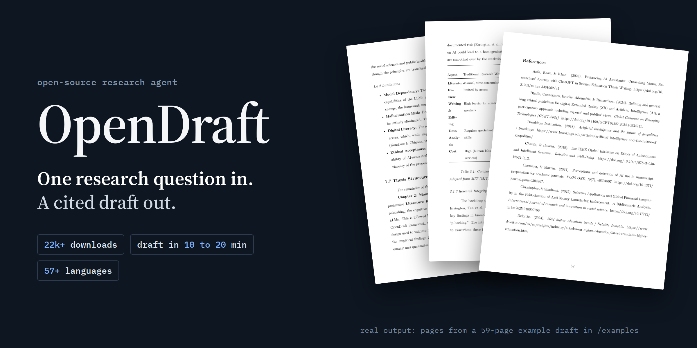
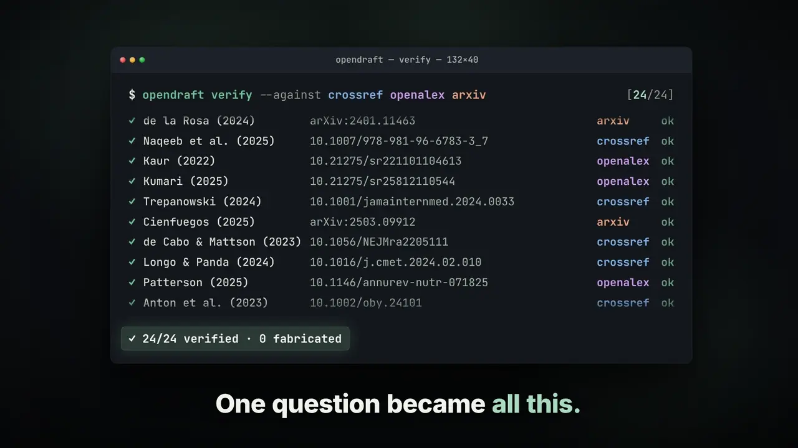

# OpenDraft: open-source AI research paper drafts with checked citations

Give your agent one topic line and get back a drafted research paper, literature review or thesis chapter, with every printed DOI checked.

```bash
npx skills add federicodeponte/opendraft --skill autonomous-research
```

Or get it on Edge: **[getedge.cc/skills/autonomous-research](https://getedge.cc/skills/autonomous-research/?utm_source=github&utm_medium=readme&utm_campaign=opendraft)**. Then ask your agent: `Write a paper on <topic>`.

Prefer a hosted app? [Use OpenPaper](https://openpaper.dev/). Want the Python engine? [Run the engine yourself](#run-the-engine-yourself).

<p align="center">
  <a href="examples/Why_Academic_Thesis_AI_Saves_The_World.pdf"></a>
</p>

<p align="center">
  <a href="https://github.com/federicodeponte/opendraft/stargazers"></a>
  <a href="https://pypi.org/project/opendraft/"></a>
  
  <a href="https://getedge.cc/?ref=opendraft-github"></a>
</p>

<p align="center">
  Ask a research question. OpenDraft searches CrossRef, OpenAlex and Semantic Scholar, writes the draft,<br>
  and keeps only sources whose DOI appears in at least two of those databases. Export to PDF, Word or LaTeX.
</p>

<p align="center">
  <b>Use the OpenDraft research skill in your own AI agent, free → <a href="https://getedge.cc/skills/autonomous-research/?utm_source=github&utm_medium=readme&utm_campaign=opendraft">getedge.cc/skills/autonomous-research</a></b>
</p>

<p align="center">
  
  <br><sub>Launch reel (stylised). Real output: the <a href="examples/Why_Academic_Thesis_AI_Saves_The_World.pdf">59-page example draft</a> in <code>/examples</code>.</sub>
</p>

---

## Use OpenDraft in Claude Code or Codex

Connect Edge, then ask your agent to research a topic and draft a paper with citations.

```text
Read https://getedge.cc/SKILL.md?ref=opendraft-github and help me connect Edge if needed.

Once Edge is available, find and load the OpenPaper x OpenDraft skill and write a cited research draft on [YOUR TOPIC].

If a restart is required, give me the exact prompt to resume.
```

Replace [YOUR TOPIC], then paste into your agent.

---

## At a Glance

| | |
|:---|:---|
| **What it is** | Open-source Python engine for AI-generated research drafts with citations checked against CrossRef, OpenAlex and Semantic Scholar |
| **Best for** | Literature reviews, research papers, thesis drafts, reproducible research workflows |
| **Agents** | 19 specialized AI agents (research, structure, writing, citation, polish, export) |
| **Sources** | CrossRef, OpenAlex, Semantic Scholar (200M+) |
| **Languages** | 57+ languages including English, Spanish, German, French, Chinese, Japanese |
| **Export** | PDF, Microsoft Word (.docx), LaTeX |
| **Cost** | Free and open source (MIT license); you bring your own model API keys. |
| **Typical output** | 5–80+ pages, 10k–20k+ words, 30–50+ citations ([measured before multi-source confirmation was made the default](#citation-verification)) |
| **Time to draft** | 10–20 minutes |
| **API cost per draft** | ~$0.35 (Gemini Flash) to ~$3.00 (Claude Opus) |

---

## OpenDraft vs other AI research tools

Looking for an open-source alternative to ChatGPT, Elicit, SciSpace or Jenni for research writing? Here is where OpenDraft fits.

| | **OpenDraft** | ChatGPT | Elicit | SciSpace | Jenni AI |
|:---|:---|:---|:---|:---|:---|
| **Built for** | A full cited draft (5–80+ pages, PDF/Word/LaTeX) from one question | General chat and writing | Finding and summarising papers | Reading and reviewing papers | Writing alongside you |
| **Open source** | Yes (MIT) | No | No | No | No |
| **Self-hosted, your own model key** | Yes | No | No | No | No |
| **Citation rule in public code** | Yes: a DOI must be held by 2 of CrossRef, OpenAlex, Semantic Scholar | Closed source | Closed source | Closed source | Closed source |
| **Price** | Free; ~$0.35–$3 model cost per draft | Freemium | Freemium | Freemium | Freemium |

OpenDraft is a drafting engine, not a replacement for reading the sources. Use the tools above to explore literature; use OpenDraft when you need a structured first draft with checked citations.

---

## Table of Contents

- [At a Glance](#at-a-glance)
- [OpenDraft vs other AI research tools](#opendraft-vs-other-ai-research-tools)
- [What is OpenDraft?](#what-is-opendraft)
- [Why OpenDraft Exists](#why-opendraft-exists)
- [OpenDraft for Open Source Maintainers](#opendraft-for-open-source-maintainers)
- [What OpenDraft is NOT](#what-opendraft-is-not)
- [How It Works](#how-it-works)
- [Citation verification](#citation-verification)
- [Features](#features)
- [Use it as a Claude Skill](#use-it-as-a-claude-skill)
- [Run the engine yourself](#run-the-engine-yourself)
- [Which AI Model Should I Use?](#which-ai-model-should-i-use)
- [Example Output](#example-output)
- [FAQ](#faq)
- [Tech Stack](#tech-stack)
- [Contributing](#contributing)
- [Links](#links)

---

## What is OpenDraft?

**OpenDraft is an open-source Python engine that generates source-grounded research drafts using 19 specialized AI agents.** It is designed for academic researchers who need long-form documents (10,000–20,000+ words) built from citations whose DOIs are checked against public scholarly databases.

OpenDraft does not invent its citations. By default a source is only included once its DOI is held by at least **two** of CrossRef, OpenAlex and Semantic Scholar, and every citation records which databases confirmed it and which ones this engine re-queried itself. See [Citation verification](#citation-verification) for exactly what that does and does not establish.

- **OpenDraft is** a command-line tool and Python library for drafting academic papers.
- **Best for:** Researchers drafting literature reviews, journal submissions, structured research papers, and thesis first drafts.
- **License:** 100% free and open source (MIT).
- **Setup time:** ~10 minutes for local installation.

---

## OpenDraft for Open Source Maintainers

OpenDraft is not just a drafting tool — it is a **reproducible research-agent pipeline** that open-source maintainers can extend, audit, and improve.

We use Codex and OpenAI models to maintain OpenDraft itself:

- **Automated PR review** — Codex reviews contributor changes for agent logic, prompt quality, and citation handling
- **Regression test generation** — AI-assisted tests for citation accuracy, source coverage, and draft coherence
- **Issue triage** — Codex suggests labels, duplicates, and fixes for bug reports
- **Release workflow automation** — Automated changelogs, version bumps, and eval runs before each release
- **Contributor templates** — Codex-assisted onboarding for adding new agents, validators, and export formats

See [EVALUATION.md](EVALUATION.md) for the benchmark plan and [CONTRIBUTING.md](CONTRIBUTING.md) for maintainer guidelines.

---

## Why OpenDraft Exists

We built OpenDraft after repeatedly encountering AI writing tools that produced confident-sounding research drafts with hallucinated or unverifiable citations.

Academic research requires trust, sources, and accountability.

OpenDraft explores a different approach: instead of a single general-purpose model, it uses multiple specialized agents, each responsible for a specific step in the research drafting process, grounded in real academic literature.

We open-sourced OpenDraft so researchers can inspect, critique, and improve how these systems actually work.

### What Problem Does OpenDraft Solve?

1. **Citation confidence** — OpenDraft confirms each source's DOI against multiple scholarly databases and drops the ones it cannot confirm, rather than accepting model-asserted references.
2. **Long-form output** — OpenDraft generates 20,000+ word research drafts.
3. **Academic structure** — OpenDraft builds structured research outlines with proper chapter/section hierarchy.
4. **Export formats** — OpenDraft exports to PDF, DOCX, and LaTeX with academic formatting.
5. **Open source** — OpenDraft is fully open source under the MIT license and can be inspected and extended.

### Who Is OpenDraft For?

- **Researchers** preparing literature reviews, journal submissions, or structured first drafts.
- **Open-source maintainers** building tools on top of a reproducible research-drafting pipeline.
- **Graduate students** working on a master's thesis or PhD dissertation.
- **Academics** who want every citation's DOI checked against a public registry before it lands in a draft.
- **Developers** extending the agent pipeline for custom research workflows, citation validators, and export formats.

---

## What OpenDraft is NOT

OpenDraft is intentionally **not** designed for:

- One-click generation of final papers
- Cheating on assignments
- Inventing citations or bypassing peer review
- Replacing human researchers

It is a research assistance and drafting tool, not an autonomous author.

---

## How It Works

OpenDraft uses **19 specialized AI agents** that work like a research team:

```
📚 RESEARCH PHASE    → Finds candidate papers via CrossRef, OpenAlex, Semantic Scholar,
                       web search, then confirms each DOI in 2+ of
                       CrossRef/OpenAlex/Semantic Scholar and drops the rest
🏗️ STRUCTURE PHASE   → Creates research outline with chapters
✍️ WRITING PHASE     → Drafts each section with academic tone
🔍 CITATION PHASE    → Dedupes, quality-filters, then checks each surviving
                       source is actually on-topic for the paper
✨ POLISH PHASE      → Refines language and formatting
📄 EXPORT PHASE      → Generates PDF, Word, or LaTeX
```

**Result:** A complete research draft in 10-20 minutes.

---

## Citation verification

Citations are checked in two independent ways. They answer different questions
and neither substitutes for the other.

### 1. Does the work exist? (multi-source confirmation)

Discovery may find a candidate through any source. Confirmation then looks the
candidate's **DOI** up directly in each scholarly database and counts how many
hold a record for it.

**By default a citation is kept only if at least 2 of {CrossRef, OpenAlex,
Semantic Scholar} hold its DOI.** A single-source result is dropped and the drop
is logged. Accepting single-source results is an explicit opt-out
(`require_multi_source=False`), not the default.

To be exact about what "2 databases hold it" means: one of the two may be the
database that returned the candidate in the first place, which is taken at its
word rather than re-queried. The others are looked up directly by DOI. The
engine tracks this distinction internally (`confirming_sources` versus
`independently_confirmed_by`) and `verification_notes` on each citation spells
out which database found it and which ones confirmed it.

| Setting | Default | Effect |
|:---|:---|:---|
| `require_multi_source` | `True` | Drop citations fewer than `min_confirming_sources` databases hold |
| `min_confirming_sources` | `2` | How many of the three must hold the DOI |
| `allow_unconfirmed_web_sources` | `False` | Keep DOI-less web-search results (kept tagged if enabled) |
| `enable_llm_fallback` | `False` | Let the LLM assert a citation when every lookup fails |

Every citation in `bibliography.json` carries its provenance:

| `verification_status` | Meaning |
|:---|:---|
| `multi_source_confirmed` | The DOI is held by `min_confirming_sources` or more databases, listed in `verification_sources` |
| `single_source` | Exactly one database holds the DOI. Dropped under the default settings |
| `unconfirmed` | The DOI carries no record in **any** scholarly database. Dropped under the default settings |
| `web_search_unconfirmed` | No DOI, so no scholarly database could be queried. Zero databases confirmed it |
| `llm_unverified` | Asserted by the LLM with no external lookup of any kind. Nothing checked that it exists |
| `not_checked` | Confirmation was disabled for this run |

`verification_sources` is written out even when it is empty, precisely so an
unconfirmed citation can never serialize to look like a confirmed one.

**What this establishes, and what it does not.** A confirmation means the DOI is
registered and indexed in that many databases. It does not mean the work
supports the sentence it is attached to, and it is not three separately sourced
attestations of the same facts: OpenAlex and Semantic Scholar both ingest
Crossref metadata, so the three are not fully independent of one another.

arXiv is not queried as a citation database. `arxiv.org` can appear as a
web-search result and Semantic Scholar exposes arXiv IDs, but there is no arXiv
API client in this engine.

### 2. Does the source support the claim? (claim-level verification)

A real, correctly cited, multi-source-confirmed paper can still be attached to a
claim it says nothing about. Existence checking cannot detect that, so
`CitationClaimVerifier` judges each source against the claim it is cited for and
returns `RELEVANT`, `IRRELEVANT` or `UNCERTAIN`.

In the citation phase this runs against the **paper topic**, because that phase
executes before any draft text exists and the topic is the only claim available
at that point. Sentence-level checking needs a draft and is available through
`run_citation_claim_verification()`.

Reports are written to the research folder as
`citation_claim_verification.md` and `.json`. A citation judged `IRRELEVANT` is
removed only above a confidence floor (`CLAIM_VERIFICATION_MIN_CONFIDENCE`,
default `0.7`), and the engine refuses to empty the bibliography outright.

| Env var | Default | Effect |
|:---|:---|:---|
| `ENABLE_CLAIM_VERIFICATION` | `true` | Run claim-level verification at all |
| `CLAIM_VERIFICATION_DROP_IRRELEVANT` | `true` | Remove irrelevant citations rather than only reporting them |
| `CLAIM_VERIFICATION_MIN_CONFIDENCE` | `0.7` | Confidence needed before a removal happens |

**These verdicts are language-model judgements, not proofs.** The judge reads a
citation's title and abstract, not the paper's full text. `UNCERTAIN` means
unchecked, not passing. Treat the output as evidence for a human reviewer.

### Effect on how many citations you get

Requiring two independent confirmations necessarily lets fewer candidates
through than accepting the first responder did. That is the intended trade:
fewer citations, each one confirmed by more than one database.

**A run can now fail where it previously produced a weak draft.** Strict
confirmation, the strict quality filter and claim-level removal all shrink the
bibliography, and the pipeline raises `PipelineValidationError` if no citations
survive the citation phase. If you hit that, widen the search or relax the
settings deliberately rather than by accident.

Citation counts quoted elsewhere in this README and in `EVALUATION.md` were
measured before multi-source confirmation became the default and have **not**
been re-measured since. Treat them as historical. If you need the old
behaviour, set `require_multi_source=False` — and note that citations then
carry `verification_status: not_checked` rather than being labelled confirmed.

### Human review is still required

Neither check removes the need to read the draft. See
[What OpenDraft is NOT](#what-opendraft-is-not).

---

## Features

### Citations confirmed against real databases
By default a citation is kept only if its DOI is held by at least two of CrossRef, OpenAlex and Semantic Scholar. A source only one database knows about is dropped, not quietly accepted. Every citation in `bibliography.json` carries the list of databases that confirmed it, so an unconfirmed source can never look like a confirmed one. See [Citation verification](#citation-verification).

### Write Any Type of Academic Paper
- Research papers (5-15 pages)
- Literature reviews (20-40 pages)
- Thesis drafts (30-80 pages)
- Structured reports (10-100+ pages)

### 57+ Languages Supported
English, Spanish, German, French, Chinese, Japanese, Korean, Arabic, Portuguese, Italian, Dutch, Polish, Russian, and 40+ more.

### Export to Any Format
- **PDF** - LaTeX-quality formatting
- **Microsoft Word** (.docx)
- **LaTeX source** - for journals

### 100% Free and Open Source
MIT license. Self-host with your own API keys.

### More tools in the CLI
Summaries (`opendraft tldr`), 60-second audio digests (`opendraft digest`), data fetching from World Bank, Eurostat and Our World in Data (`opendraft data`), draft revision (`opendraft revise`) and a fast research-scoping mode (`--expose`). See [docs/TOOLS.md](docs/TOOLS.md).

---

## Use it as a Claude Skill

This engine also exists as a Skill, for agents that read Skills. Claude Code is one.
The bundle lives in this repo at [`skills/autonomous-research/`](skills/autonomous-research/),
kept identical to [getedgehq/skills](https://github.com/getedgehq/skills/tree/main/autonomous-research)
by `scripts/sync_skill.sh` and a CI check.

```bash
npx skills add federicodeponte/opendraft --skill autonomous-research
```

**Get it on Edge: [getedge.cc/skills/autonomous-research](https://getedge.cc/skills/autonomous-research/?utm_source=github&utm_medium=readme&utm_campaign=opendraft)**

Then say `Write a paper on <topic>` and the agent runs the pipeline itself.

**It is a port, not a wrapper.** It does not call this Python engine and it does
not talk to any hosted service. The eighteen stages are eighteen markdown prompts
the agent executes in order, plus five standard-library Python scripts for the
parts a language model must not do by hand: source lookup, deterministic citation
compilation, an integrity gate, assembly and export. No API key, no account, and
no model of ours in the loop, because the agent reading the Skill is the model.
Every stage is a file you can open and edit.

**What differs from the engine in this repository.** The Skill queries Crossref,
OpenAlex and DataCite only, with no Semantic Scholar client, so the multi-source
confirmation rule described in [Citation verification](#citation-verification) is
not the rule it applies. Its gate is narrower and stricter in a different place:
every DOI it prints resolved at Crossref or DataCite, and `citations.py compile`
refuses to render a bibliography containing one that did not, naming the offender
and exiting nonzero. It has no hosted run history, and export goes through pandoc
rather than this repository's PDF pipeline.

**What carries over.** Claim-to-source checking is stage 11, a prompt rather than
a service call, and it still starts from the position that DOI resolution proves
a record exists and nothing more. Unsourced statistics are swept for separately,
because a fabricated number sitting beside a perfectly valid citation passes an
existence check by design. Human review is required for the same reasons it is
required here.

The Skill is published under Apache-2.0; the OpenDraft-derived material keeps its
MIT notice in the bundle's `THIRD_PARTY_NOTICES.md`, and its `DERIVATION.json`
records the SHA-256 of every shipped file and maps each prompt and script back to
its origin here.

---

## Run the engine yourself

### Prerequisites
- Python 3.10+
- A free [Gemini API key](https://makersuite.google.com/app/apikey)

### 1. Clone & Install

```bash
git clone https://github.com/federicodeponte/opendraft.git
cd opendraft
pip install -r requirements.txt
```

### 2. Configure

Create a `.env` file with your API key:
```bash
GOOGLE_API_KEY=your-gemini-api-key
```

### 3. Generate a Draft

```python
from engine.draft_generator import DraftGenerator

generator = DraftGenerator()
draft = generator.generate(
    topic="The Impact of AI on Academic Research",
    paper_type="master",  # research_paper, bachelor, master, phd
    language="en"
)

# Export to different formats
draft.to_pdf("thesis.pdf")
draft.to_docx("thesis.docx")
draft.to_latex("thesis.tex")
```

See `engine/README.md` for detailed API documentation.

---

## Which AI Model Should I Use?

| Model | Provider | Configuration |
|-------|----------|---------------|
| **Gemini 3.1 Pro Preview** | Gemini (default) | `AI_PROVIDER=gemini` |
| Gemini 3 Flash Preview | Gemini | `GEMINI_MODEL=gemini-3-flash-preview` |
| GPT-4.1 Nano | OpenAI | `AI_PROVIDER=openai` and `OPENAI_API_KEY` |
| Claude Sonnet 4.6 | Anthropic | `AI_PROVIDER=claude` and `ANTHROPIC_API_KEY` |

Set `OPENAI_MODEL` or `ANTHROPIC_MODEL` to use another model supported by your API endpoint.

---

## Example Output

See what OpenDraft produces:

Sample drafts with their DOI-checked bibliographies are in the [`examples/`](examples/) directory.

Generated in ~15 minutes, with every citation's DOI checked against CrossRef, OpenAlex and Semantic Scholar.

---

## Project Structure

```
opendraft/
├── engine/
│   ├── draft_generator.py    # Main 19-agent pipeline
│   ├── config.py             # Model & API settings
│   ├── prompts/              # Agent instruction templates
│   ├── utils/                # Citations, export, helpers
│   └── opendraft/            # Core agent modules
├── examples/                 # Sample research outputs
├── requirements.txt          # Python dependencies
└── README.md
```

---

## FAQ

### What is the best open-source AI research paper generator?
**OpenDraft** is a free, MIT-licensed engine that turns one research question into a full cited draft (5–80+ pages) using 19 specialised agents, with exports to PDF, Word and LaTeX. You run it yourself with your own Gemini, OpenAI or Claude key.

### Is there an AI that writes research papers without fake citations?
**OpenDraft does not invent citations.** By default a citation is kept only when its DOI is held by at least two of CrossRef, OpenAlex and Semantic Scholar; single-source results are dropped. One of the two may be the database that returned the candidate, which is taken at its word rather than re-queried; `verification_independent_sources` records the ones actually re-queried. The LLM-asserted fallback is off by default and, if switched on, everything it produces is tagged `llm_unverified`. This proves the cited work is registered and indexed, not that it supports the sentence it is attached to; a separate claim-level check covers that, and its verdicts are LLM judgements for a human reviewer. See [Citation verification](#citation-verification).

### Is OpenDraft free?
**Yes.** OpenDraft is 100% free and open source under the MIT license. You self-host it with your own model API keys; a typical draft costs ~$0.35–$3 in API fees.

### Can OpenDraft write a literature review or a thesis?
**Yes, as a first draft.** It drafts literature reviews, research papers and thesis chapters, and can produce a complete first draft of a PhD dissertation (100+ pages). It is a drafting assistant, not an autonomous author: verify the sources, add your own analysis, and check your institution's AI policy before submitting.

### How long does it take to generate a paper with OpenDraft?
**10–20 minutes** for a full master's thesis (50–80 pages). A shorter research paper takes 5–10 minutes.

### What file formats does OpenDraft export to?
**PDF, Microsoft Word (.docx), and LaTeX source.**

### Can I use OpenDraft commercially?
**Yes.** The MIT license permits commercial use, modification and distribution.

### Why a multi-agent architecture?
OpenDraft uses **19 specialised agents** (research, citations, structure, writing, polish, export) instead of one general-purpose prompt, so each stage can be checked and improved on its own.

---

## Mentioned in

- *AI for Auto-Research: Roadmap & User Guide* (Kong, Sun, Chow et al., 2026), [arXiv:2605.18661](https://arxiv.org/abs/2605.18661): listed as the full-draft generation system in the paper-writing table.
- Daniel Kornaś, [LinkedIn post, Oct 2026](https://www.linkedin.com/posts/daniel-kornas_research-drafts-need-sources-you-can-trace-activity-7511300253900480512-YVVp).

---

## Tech Stack

- **Engine:** Python 3.10+, multi-agent orchestration
- **Models:** Google Gemini 3, Anthropic Claude Sonnet 4.5 / Opus 4.5, OpenAI GPT-5.5 / GPT-5
- **Citations:** CrossRef API, OpenAlex API, Semantic Scholar API
- **Export:** WeasyPrint (PDF), python-docx (Word)

---

## Contributing

Contributions welcome!

**Ideas:**
- Add new AI model support
- Improve citation accuracy
- Add export formats
- Translate prompts

Maintainer workflow docs:
- Push/auth runbook: `docs/MAINTAINER_PUSH_RUNBOOK.md`
- Automated push preflight: `scripts/push-preflight.sh`

---

## Links

- 🌐 **Hosted version:** [openpaper.dev](https://openpaper.dev)
- 💬 **Discussions:** [GitHub Discussions](https://github.com/federicodeponte/opendraft/discussions)
- 🐛 **Issues:** [Report Bug](https://github.com/federicodeponte/opendraft/issues)
- 🗒️ **Changelog:** [CHANGELOG.md](CHANGELOG.md)
- 📜 **License:** [MIT](LICENSE)

---

## Summary

**OpenDraft** is a free, open-source Python engine for generating academic research drafts. It uses 19 specialized AI agents, and by default keeps a citation only once its DOI is held by at least two of CrossRef, OpenAlex and Semantic Scholar.

---

<p align="center">
  <b>If OpenDraft helps your research, please star the repo!</b><br><br>
  <a href="https://github.com/federicodeponte/opendraft">⭐ Star on GitHub</a>
</p>
