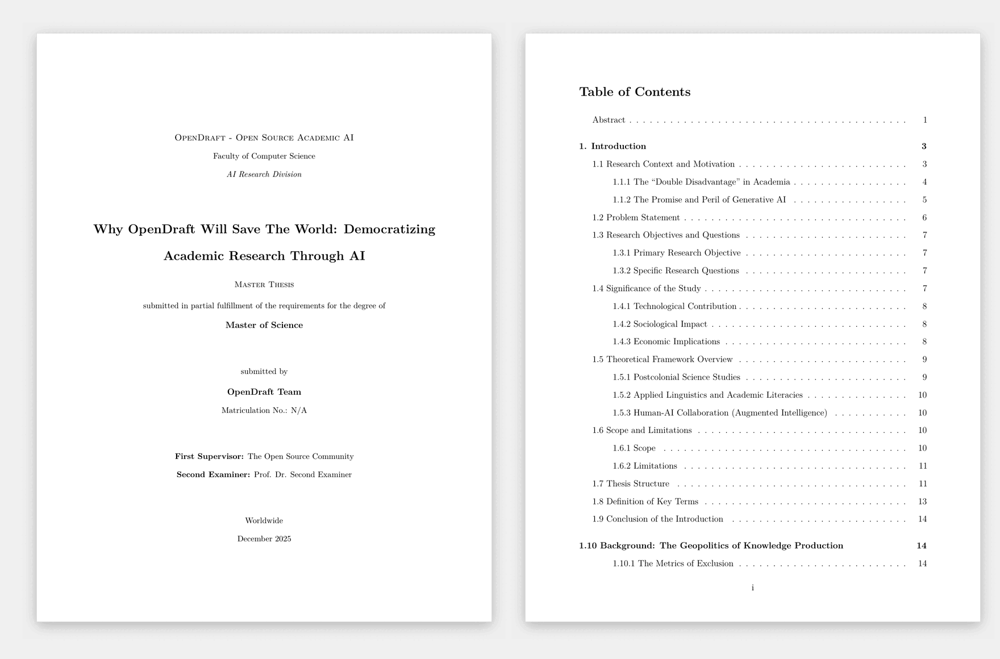

# OpenDraft: open-source research paper and thesis writer with verified citations

**The open-source agent system that writes research papers with verified citations.**

OpenDraft drafts research papers, literature reviews and thesis chapters from one topic, and keeps a citation only if at least two of Crossref, OpenAlex and Semantic Scholar hold its DOI. An open-source alternative to Jenni and ThesisAI: MIT licensed, runs on your own model key.

**Website: [opendraft.xyz](https://opendraft.xyz)** · [Docs](https://opendraft.xyz/docs) · [Sample PDF](examples/Why_Academic_Thesis_AI_Saves_The_World.pdf) · [Hosted version (OpenPaper)](https://openpaper.dev/)

[](https://pypi.org/project/opendraft/)
[](https://pepy.tech/projects/opendraft)
[](https://github.com/federicodeponte/opendraft)
[](LICENSE)

**Use OpenDraft as a skill in your own agent (Claude, ChatGPT), free → [getedge.cc/skills/autonomous-research](https://getedge.cc/skills/autonomous-research/?utm_source=github&utm_medium=readme&utm_campaign=opendraft)**

<p align="center">
  <a href="examples/Why_Academic_Thesis_AI_Saves_The_World.pdf"></a>
  <br><sub>Real output: pages from the <a href="examples/Why_Academic_Thesis_AI_Saves_The_World.pdf">sample draft</a> (60 pages, 40+ citations).</sub>
</p>

## Cited in research

- **Talukder et al. (2026)**, [*Discourse2Draft: an AI-powered structured document writing tool*](https://doi.org/10.3389/frai.2026.1945655), *Frontiers in Artificial Intelligence*. Peer-reviewed NIH paper, next to Stanford's STORM ([comparison](docs/opendraft-vs-storm.md)).
- **Kong et al. (2026)**, [*AI for Auto-Research: Roadmap & User Guide*](https://arxiv.org/abs/2605.18661), arXiv:2605.18661. NUS survey of research agents.

**24k+ downloads:** [20,289 on PyPI](https://pepy.tech/projects/opendraft) (pepy.tech) and [4,200 on npm](https://www.npmjs.com/package/opendraft), as of November 2026.

## Quickstart

Requires Python 3.10+ and a Gemini API key (Claude and OpenAI also work).

```bash
pip install opendraft
opendraft setup                      # enter your Gemini API key
opendraft "Remote work and team productivity"
```

| Command | What it does |
|:---|:---|
| `opendraft` | Interactive mode |
| `opendraft "Topic" --level phd --lang de` | Draft at a level (`research_paper`, `bachelor`, `master`, `phd`) and language |
| `opendraft "Topic" --expose` | Outline and sources only, faster |
| `opendraft revise ./output "make the intro longer"` | Revise a draft |
| `opendraft tldr paper.pdf` | 5-bullet summary of any paper |

## Use it as a skill

In Claude Code, Codex or any agent that reads skills:

```bash
npx skills add federicodeponte/opendraft --skill autonomous-research
```

Then ask: `Write a paper on <topic>`. The skill lives in [`skills/autonomous-research/`](skills/autonomous-research/); it runs inside your agent and does not call this Python engine.

## Run the engine yourself

```bash
git clone https://github.com/federicodeponte/opendraft.git
cd opendraft
pip install -e ./engine
cp .env.example engine/.env          # add your key
opendraft "Your topic"
```

| Variable | Required | Purpose |
|:---|:---|:---|
| `GOOGLE_API_KEY` | One key required | Gemini (default provider) |
| `ANTHROPIC_API_KEY` / `OPENAI_API_KEY` | Optional | Claude or OpenAI, with `AI_PROVIDER=claude` or `openai` |
| `ENABLE_SEMANTIC_SCHOLAR` | Optional | Set `false` if Semantic Scholar rate-limits you |

All settings are listed in [`.env.example`](.env.example).

## How it works

19 agents work in six phases: research, structure, compose, validate, refine, enhance. A source stays only if at least two of Crossref, OpenAlex and Semantic Scholar hold its DOI. That proves the work exists, not that every claim about it is right, so a second check judges whether each source fits its claim. Details: [citation verification](docs/citation-verification.md) · [pipeline](docs/PIPELINE.md) · [methodology](https://opendraft.xyz/methodology).

## FAQ

**What is OpenDraft?**
An open-source agent system that researches and writes papers with verified citations. MIT licensed.

**Is OpenDraft free?**
Yes. You pay only your model provider, about $0.35 to $3 per draft.

**How are citations verified?**
A source stays only if at least two of Crossref, OpenAlex and Semantic Scholar hold its DOI. That proves it exists, not that every claim about it is right.

**How long does a draft take, and in what formats?**
Usually 10 to 20 minutes. Export to PDF, Word and LaTeX.

**Who has cited OpenDraft?**
A peer-reviewed NIH paper (Talukder et al., 2026), next to Stanford's STORM, and the NUS survey *AI for Auto-Research* (Kong et al., 2026).

**Are the drafts ready to submit?**
No. They are starting points: review and edit before use, and follow your institution's policy on disclosure.

## Contributing

Issues and pull requests are welcome. See [CONTRIBUTING.md](CONTRIBUTING.md), ask in [Discussions](https://github.com/federicodeponte/opendraft/discussions), and read the [changelog](CHANGELOG.md).

## License

MIT, see [LICENSE](LICENSE). To cite OpenDraft, use [CITATION.cff](CITATION.cff) ("Cite this repository" on GitHub).
